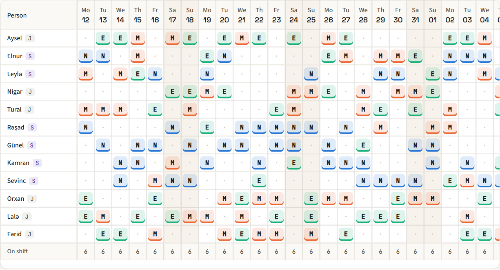
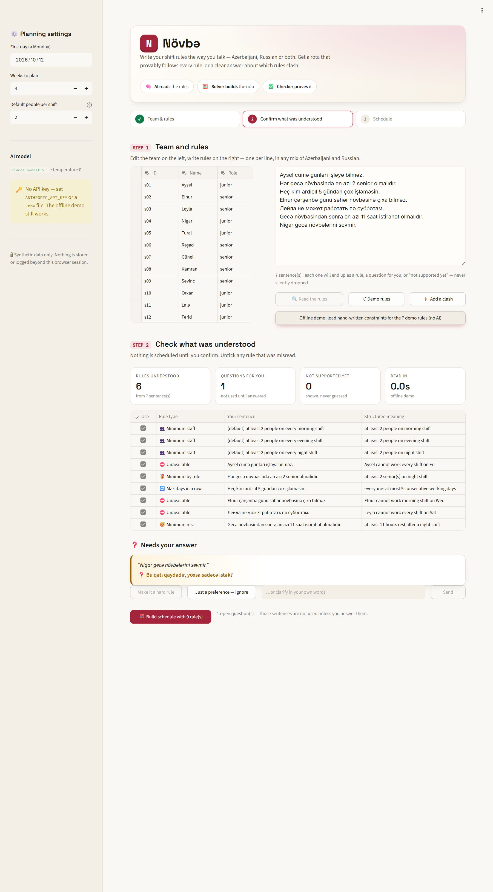
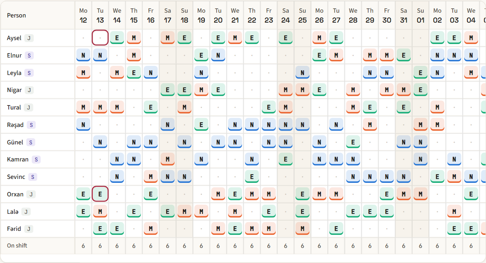

# Növbə — shift rules in plain language, a rota that provably follows them

Managers write shift rules the way they talk — in Azerbaijani, Russian, or both mixed, with or without diacritics. Növbə turns each sentence into a structured rule, shows it back for confirmation, and then a constraint solver (OR-Tools CP-SAT) builds the rota. An independent checker re-verifies every rule on the final rota; if the rules cannot all hold, Növbə names exactly which rules clash instead of returning a broken schedule.



**The LLM never writes the schedule.** It only translates text into constraints and phrases explanations of facts the code has already computed.

## Architecture

```
rules text (AZ / RU / mixed)
   │
   ▼
parser.py ── LLM (temperature 0, JSON, pydantic-validated, 1 retry) ──► 8 typed constraints
   │            names resolved to staff ids in code, never by the LLM
   │            every sentence → exactly one of: constraint | ambiguous (ask) | unsupported (say why)
   ▼
confirm (UI) ── manager ticks rules, answers ambiguous questions
   │
   ▼
solver.py ── CP-SAT, one assumption literal per rule
   │            feasible  → balanced rota
   │            infeasible → infeasibility core, shrunk to a minimal set of clashing rules
   ▼
verifier.py ── independent plain-Python re-check of every rule (does not import the solver)
   │
   ▼
UI: grid + "0 rule violations (independent check)" · absence → repair.py (minimum changed shifts)
                                                    · conflict → explain.py (LLM wording, number-checked, template fallback)
```

## Run

```bash
pip install -r requirements.txt
```

Set your key (or copy `.env.example` to `.env`):

```bash
export ANTHROPIC_API_KEY=sk-ant-...
```

```bash
streamlit run app.py
```

Optional: `NOVBE_MODEL` (default `claude-sonnet-5-5`). Without a key the UI still offers an offline fallback that loads hand-written constraints for the demo rules (clearly labelled, no AI), so the solver, verifier and repair can be tried.

Tests and evaluation:

```bash
pytest -q
```

```bash
python -m eval.gen_cases && python -m eval.run_eval && python -m eval.make_testing
```

Results: [docs/TESTING.md](docs/TESTING.md) (generated from `eval/results/`).

End-to-end UI test (Playwright, headless Chromium): starts the app, reads the demo rules, builds the rota, checks for "0 rule violations", repairs an absence, checks a 390 px phone layout for horizontal overflow, and saves screenshots to `docs/screenshots/`:

```bash
pip install -r requirements-dev.txt && python -m playwright install chromium
```

```bash
python scripts/ui_smoke.py
```

## Screens

| Confirm what was understood | Rota after a sick-day repair (changed seats outlined) |
|---|---|
|  |  |

Each shift is shown by a letter (M/E/N) plus its color, so it never relies on color alone; hover any cell for person, date and shift. The grid scrolls sideways on small screens while names stay pinned.

## Supported rule types (exactly 8)

| type | example |
|---|---|
| `unavailable` | "Aysel cümə günləri işləyə bilməz." |
| `max_consecutive_days` | "Heç kim ardıcıl 5 gündən çox işləməsin." |
| `min_staff` | "Hər axşam növbəsində ən azı 3 nəfər olsun." |
| `min_role` | "Hər gecə növbəsində ən azı 2 senior olmalıdır." |
| `max_hours_week` | "Никто не работает больше 40 часов в неделю." |
| `min_rest_hours` | "Gecə növbəsindən sonra ən azı 11 saat istirahət olmalıdır." |
| `fixed_assignment` | "Leyla 14 oktyabrda səhər növbəsində işləyir." |
| `max_shifts_week` | "Elnur həftədə 4 növbədən çox işləməsin." |

Shifts: morning 07–15, evening 15–23, night 23–07 (8 h each). A default coverage rule (2 people per shift, adjustable) is added visibly to every plan.

## Honest limits

- Rules outside the 8 types (e.g. "A and B must not work together", fair weekend rotation) are **flagged as not supported yet**, never guessed. Preferences ("doesn't like nights") are asked about, never assumed hard.
- Tested on synthetic teams of 9–14 people over 2 weeks (eval) and 12 people over 4 weeks (demo). Larger teams should work but are not measured.
- The parser can still misread a rule; that is why every parsed rule is shown with its source sentence for confirmation. The eval measures parsing accuracy without that human check.
- Only senior/junior roles; no skills, pay or legal rules.
- Synthetic data only. Nothing is stored or logged beyond the Streamlit session.

See [docs/DISCLOSURE.md](docs/DISCLOSURE.md) for models, libraries and data.
